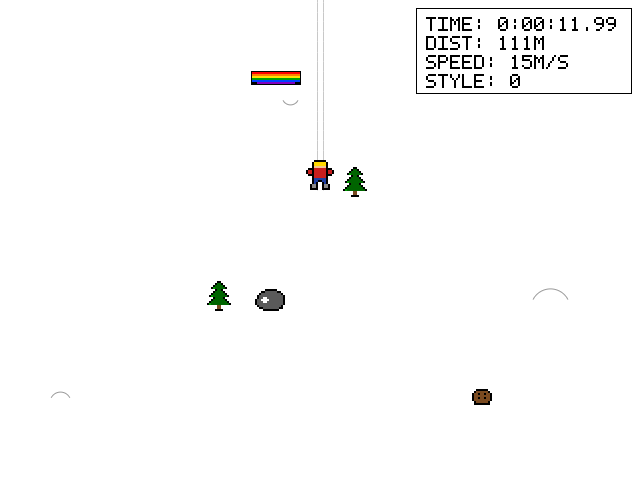
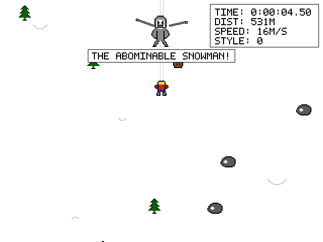
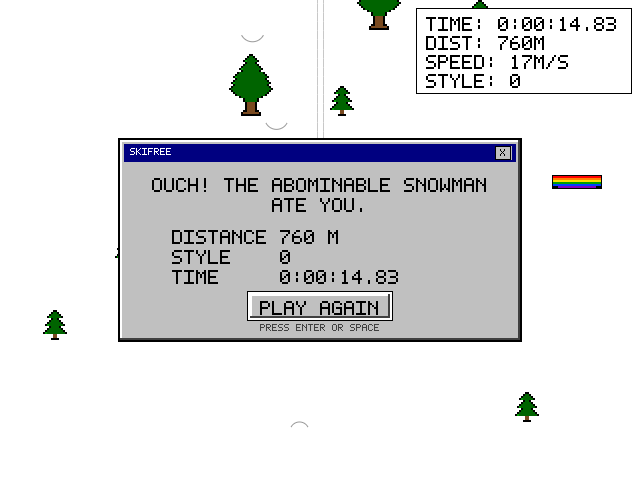

# 🎿 SkiFree — The Yeti Is Back.

**A nostalgic SkiFree-inspired browser game, rebuilt with AI-assisted development.**

One HTML file. Zero dependencies. One very hungry snowman.



## 🕹️ Play the game

Download `index.html`, open it in your browser, and start skiing.

No installation. No frameworks. No dependencies.

## Features

- ❄️ Procedurally generated snowy slopes
- 🎿 Smooth skiing and steering physics
- 🌲 Trees, rocks, obstacles, and collisions
- 🏂 Jumps, ramps, and style points
- 👹 The legendary Abominable Snowman chase
- 🔊 Synthesized sound effects with Web Audio
- 🖥️ Nostalgic Windows 3.1 / 95-inspired interface
- 📦 Completely self-contained HTML file

## Controls

| Key | Action |
|---|---|
| Arrow keys / WASD | Steer |
| F / Shift | Boost |
| Space | Jump |
| R / F2 | Restart |

## Screenshots

### The slopes


### The chase


### Game over


## Built with

- HTML5 Canvas
- Vanilla JavaScript
- CSS
- Web Audio API
- OpenCode + REA

No external libraries or game engines.

## Testing

The project includes a Playwright verification suite.

**75/75 automated checks passed.**

## Run locally

1. Clone this repository.
2. Open `index.html` in your browser.
3. Start skiing.

```bash
git clone https://github.com/nosnekulLeoN/skifree.git
cd skifree
```

## Credits

Created by **SynapseSpiral**.

A tribute to the classic SkiFree experience.

*Watch out for the snowman.*
